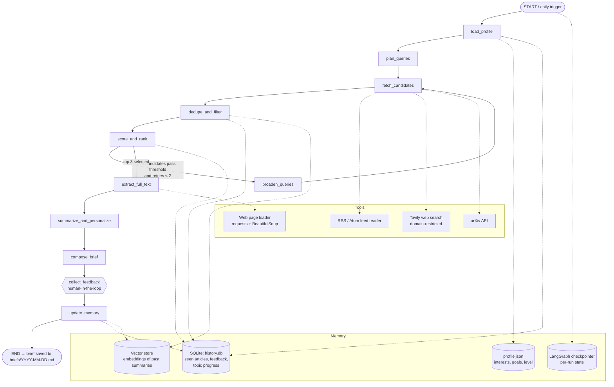

# DailyTechUpgradeAgent — Architecture

## 1. Goal

**Purpose:** Help me become a better technical learner every day by finding, ranking, and explaining the three most useful technical articles published recently by authoritative sources.

**Expected outcome (each day):** A *Daily Tech Brief* containing the top 3 articles, each with:
- title, source, publication date, URL (verified, never LLM-generated)
- a technical summary and 3–5 key takeaways
- "Why this matters for me" — link to my interests, skill gaps, and career goals
- estimated reading time, so that the whole session fits in **15–20 minutes**

Over time the agent learns from my feedback and reading history, avoids repeats, and steers toward topics I haven't covered yet.

---

## 2. High-level workflow

The agent is a **LangGraph `StateGraph`**: a deterministic pipeline with one retry loop and one human-in-the-loop step. LLM calls are used only where judgment is needed (ranking, summarizing, personalizing); fetching, filtering, and metadata are plain code so references stay accurate.



---

## 3. Graph state

```python
class Article(TypedDict):
    url: str
    title: str
    source: str            # e.g. "Anthropic", "AWS ML Blog", "IEEE Spectrum"
    published: date
    snippet: str           # from feed/search result
    full_text: str | None
    word_count: int | None
    topics: list[str]
    scores: dict[str, float]   # relevance, authority, novelty, depth, recency
    total_score: float

class BriefState(TypedDict):
    run_date: date
    profile: dict                  # loaded from profile.json + derived progress
    queries: list[str]
    candidates: list[Article]      # raw fetched
    filtered: list[Article]        # after dedupe/filter
    selected: list[Article]        # top 3
    summaries: list[dict]          # per-article summary, takeaways, why_it_matters, read_minutes
    brief_markdown: str
    feedback: list[dict]           # ratings collected after the brief
    retries: int
```

---

## 4. Nodes

| Node | Type | What it does | Reads / writes |
|---|---|---|---|
| `load_profile` | code | Loads static interests and goals from `profile.json`; derives *learning progress* from SQLite (topics covered recently, topics rated "want more", under-covered interests). | M1, M2 → `profile` |
| `plan_queries` | LLM | Turns the profile into 5–8 search queries, weighting under-covered interests (e.g. "LangGraph multi-agent memory", "RAG evaluation"). | `profile` → `queries` |
| `fetch_candidates` | tools | Pulls the last 72 h of posts from source feeds and arXiv; runs domain-restricted Tavily searches for each query. Captures title, URL, date, and source **from the tool response**. | → `candidates` |
| `dedupe_and_filter` | code | Normalizes URLs; drops items already in `history.db`; drops near-duplicates (embedding similarity > 0.9 to past summaries); drops non-allow-listed domains, items with no date, and items older than the window. | M2, M3 |
| `score_and_rank` | LLM + code | LLM scores each candidate 1–5 on relevance, depth, and novelty using structured output; code adds authority (source tier) and recency. Applies weighted sum plus a diversity rule (≤1 article per source, distinct topics). | → `selected` |
| `broaden_queries` | LLM | Runs only if fewer than 3 candidates pass the threshold. Widens the time window (72 h → 7 days) and/or rewrites queries. Max 2 retries; then falls back to the best available. | `retries += 1` |
| `extract_full_text` | tool | Fetches each selected page and extracts the main text (bs4). On failure, falls back to the feed/search snippet and flags the summary as "snippet-based". | → `full_text`, `word_count` |
| `summarize_and_personalize` | LLM | For each article: a 4–6 sentence technical summary, 3–5 key takeaways, "why this matters for me" (tied to specific profile goals), one follow-up question to think about, and a suggested reading scope that fits the time budget. | → `summaries` |
| `compose_brief` | code (template) | Renders the Markdown brief: header, total time, 3 article cards, references section. Title, date, source, and URL are inserted from `Article` fields, not LLM output. | → `brief_markdown` |
| `collect_feedback` | human-in-the-loop | LangGraph `interrupt()`: asks for a 1–5 rating per article and optional "more/less like this" tags. Skippable (defaults to no feedback). | → `feedback` |
| `update_memory` | code | Writes the selected articles, topics, and feedback to SQLite; adds summary embeddings to the vector store; updates per-topic exposure counts. Saves the brief to `briefs/YYYY-MM-DD.md`. | M2, M3 |

---

## 5. Tools and data sources

**Tools** (each wrapped with `@tool` so they can also be called by an LLM agent if needed):

| Tool | Purpose |
|---|---|
| `fetch_feeds(sources, since)` | Reads RSS/Atom feeds with `feedparser`; returns normalized `Article` records. |
| `search_web(query, domains, days)` | Tavily search restricted to the allow-listed domains and a recent time window, for sources without usable feeds. |
| `search_arxiv(query, since)` | arXiv API for recent papers (cs.AI, cs.CL, cs.LG). |
| `load_page(url)` | `requests` + BeautifulSoup main-content extraction (as in `LangGraph_LangChain_agents.ipynb`). |

**Source allow-list with authority tiers** (stored in `sources.yaml`; feed URLs are checked when implementing):

| Tier | Sources | Access method |
|---|---|---|
| 1 — Primary labs/vendors | OpenAI, Anthropic, Google (AI/Research/DeepMind), Microsoft (Research / Azure AI), AWS (ML blog), IBM Research, LangChain/LangGraph blog | RSS where available, otherwise Tavily with `include_domains` |
| 1 — Research bodies | IEEE (Spectrum, Xplore), ACM (CACM, Queue), arXiv | RSS / arXiv API / Tavily |
| 2 — Reputable engineering publications | e.g. Hugging Face blog, Meta AI, NVIDIA Technical Blog, The Gradient | RSS / Tavily |

---

## 6. Memory design

| Store | Kind | Contents | Used for |
|---|---|---|---|
| `profile.json` | long-term, user-edited | interests (weighted), current skill level per area, career goals (e.g. "ML engineer internship, summer 2027"), preferred depth | query planning, relevance scoring, "why it matters" |
| `history.db` (SQLite) | long-term, agent-written | `articles_seen(url, title, source, published, topics, score, shown_on)`<br>`feedback(url, rating, tags, date)`<br>`topic_progress(topic, exposures, last_seen, avg_rating)` | dedupe, learning-progress signal, evaluation metrics |
| Vector store (`InMemoryVectorStore`, persisted to `data/summary_vectors.json`) | long-term semantic | embeddings of past article summaries | novelty scoring, near-duplicate filtering |
| LangGraph checkpointer (`SqliteSaver` / `InMemorySaver`) | short-term, per run | full `BriefState` per `thread_id = run_date` | resuming after `interrupt()`, debugging, re-running a day |

**How personalization uses memory:**
- Topics with high `avg_rating` get a relevance boost; topics tagged "less like this" get a penalty.
- Interests with low `exposures` in the last 14 days get extra queries in `plan_queries` (spreading coverage).
- Articles too similar to anything already read get a lower novelty score.

---

## 7. Ranking and time budget

**Score** (each component normalized 0–1):

```
total = 0.35·relevance + 0.20·depth + 0.20·novelty + 0.15·authority + 0.10·recency
```

Selection = top 3 by `total`, subject to: at most one article per source, three distinct primary topics, and `total ≥ 0.6` (otherwise → `broaden_queries`).

**15–20 minute budget:** reading time = `word_count / 230 wpm`. The brief itself takes about 5 minutes; the remaining ~12 minutes are split across the 3 articles. For long articles or papers, `summarize_and_personalize` names the specific sections to read (e.g. "Read §3 Method and §5 Results") instead of the whole piece. The brief header shows the total estimated time.

---

## 8. Output format (`briefs/YYYY-MM-DD.md`)

```
# Daily Tech Brief — Oct 29, 2026   (≈18 min)
Focus today: agent memory · RAG evaluation · cloud inference cost

## 1. <Title>
Source: <Source> · Published: <date> · <URL> · ~5 min
Summary: ...
Key takeaways: • ... • ... • ...
Why this matters for you: ...
Think about: <one question>

## 2. ...
## 3. ...

### References
1. <Title>. <Source>, <date>. <URL>
...
```

---

## 9. Reliability and guardrails

- **No invented references:** metadata comes only from tool results; `compose_brief` checks that every URL in the brief appears in `selected`.
- **Link check:** an HTTP HEAD/GET on each selected URL before summarizing; unreachable links are swapped for the next-ranked candidate.
- **Grounded summaries:** the summarization prompt includes only the extracted text; if extraction failed, the card is labeled "summary based on abstract/snippet".
- **Fallbacks:** feed failure → Tavily only; Tavily failure → feeds only; < 3 results after retries → publish fewer articles with a note instead of padding.
- **Tracing:** LangSmith tracing enabled for debugging and evaluation.

---

## 10. Evaluation hooks (built into the architecture)

| Metric | How it is measured | Where the data comes from |
|---|---|---|
| Reference accuracy | % of URLs that resolve and whose title/date match the page | link check in `extract_full_text` |
| Summary faithfulness | LLM-as-judge: each takeaway supported by the source text (score 1–5) | offline eval script over saved state |
| Relevance | average user rating; precision@3 (ratings ≥ 4) | `feedback` table |
| Novelty / diversity | % of articles not similar to history; distinct sources and topics per week | vector store, `articles_seen` |
| Time-budget fit | % of briefs with estimated time in 15–20 min | `brief` metadata |
| Learning progress | topic coverage over time vs. profile interests; trend in ratings; optional 3-question self-quiz per brief | `topic_progress` |

---

## 11. Tech stack and file layout

**Stack:** Python 3.12, LangGraph, LangChain (`init_chat_model` / `init_embeddings`, so the provider is set by a `provider:model` string in `.env`; default chat model `anthropic:claude-opus-5-5`, default embeddings `openai:text-embedding-3-small`), Tavily, feedparser, requests + BeautifulSoup, SQLite, `InMemoryVectorStore` persisted to JSON, LangSmith. A daily run can be scheduled with cron.

```
agent1_daily_tech_upgrade/
├── ARCHITECTURE.md        # this file
├── profile.json           # my interests, level, goals
├── sources.yaml           # allow-listed sources, tiers, feed URLs
├── config.py              # paths, weights/thresholds, model factories
├── state.py               # BriefState, Article, structured-output schemas
├── nodes.py               # one function per graph node + routing
├── agent.py               # StateGraph wiring + CLI (feedback interrupt loop)
├── tools.py               # fetch_feeds, search_web, search_arxiv, load_page, url_resolves
├── memory.py              # SQLite schema/helpers + vector store helpers
├── prompts.py             # planning, scoring, summarizing prompts
├── evaluate.py            # offline metrics over saved runs
├── demo.ipynb             # working prototype walkthrough
├── tests/                 # pytest
├── briefs/                # generated daily briefs (sample results)
└── data/                  # history.db, checkpoints.db, summary_vectors.json (gitignored)
```
