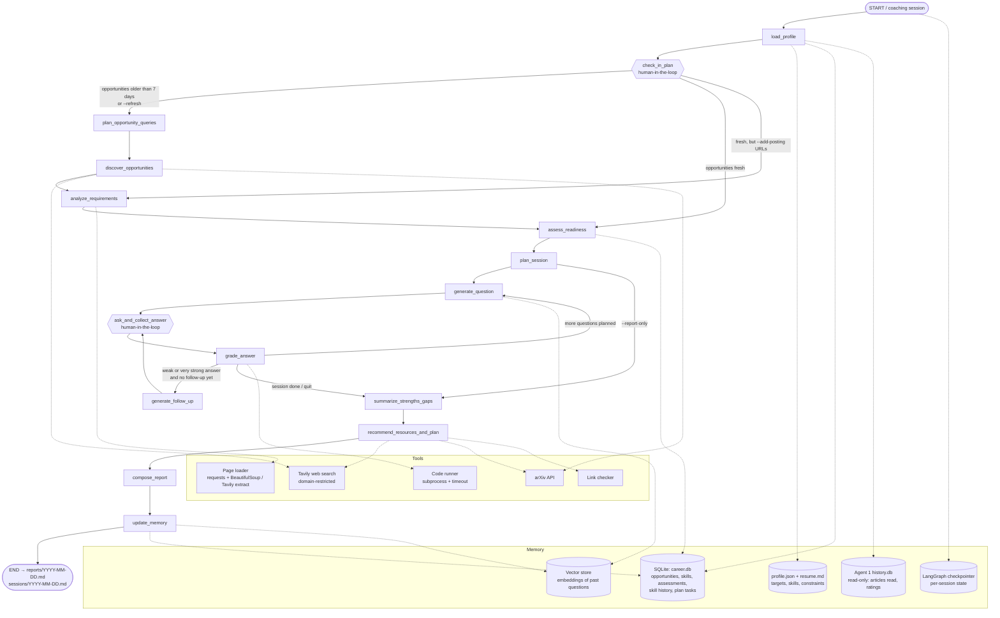

# nextLevelPersonalCoachForCareerLevel — Architecture

## 1. Goal

**Purpose:** Prepare me for my next career or entrepreneurial step by finding concrete opportunities, measuring how ready I am for them, practicing with me interactively, and tracking my progress until I get there.

**Expected outcome (each coaching session):** a *Career Readiness Report* containing:
- target roles and the matched opportunities (internships, jobs, research, entrepreneurial), each with organization, type, deadline, and a verified URL (never LLM-generated)
- the skills those opportunities require, ranked by how often and how strongly they are asked for
- a technical assessment from today's interactive session: every question, my answer, the score per rubric criterion, and written feedback
- strengths, knowledge gaps, and a per-skill readiness score, with the change since the last session
- recommended learning resources (verified URLs) and a 2-week preparation plan with concrete, checkable tasks
- overall readiness for each target role, and the trend over time

The full session transcript is saved too, as the sample of an interactive coaching session.

Over time the agent focuses questions on my weakest high-priority skills, raises difficulty where I improve, checks in on plan tasks, and uses what I read through Agent 1 as learning evidence.

---

## 2. High-level workflow

The agent is a **LangGraph `StateGraph`** with two human-in-the-loop steps (plan check-in and the question loop) and one conditional branch (opportunity discovery runs only when the stored opportunities are stale). As in Agent 1, LLM calls are used only where judgment is needed (extracting skills, writing and grading questions, coaching); search, links, scoring math, and report metadata are plain code.



---

## 3. Graph state

```python
class Opportunity(TypedDict):
    url: str
    title: str                     # from the tool result / page, not the LLM
    org: str
    type: Literal["internship", "job", "research", "entrepreneurial"]
    location: str | None
    deadline: date | None          # as stated on the page; None if not stated
    found_on: date
    requirements: list[SkillReq]   # from analyze_requirements
    fit_score: float               # 0-1

class SkillReq(TypedDict):
    skill: str                     # canonical name from skills.yaml (or "other:<raw>")
    level: int                     # 1 = familiarity, 2 = working knowledge, 3 = strong / production
    required: bool                 # required vs preferred
    evidence: str                  # short quote from the posting

class Question(TypedDict):
    id: str
    skill: str
    kind: Literal["concept", "coding", "scenario"]
    difficulty: int                # 1-3
    prompt: str
    grounding: str | None          # posting/article excerpt or URL the question is based on
    reference_answer: str          # hidden from me; used by the grader
    rubric: list[str]              # criteria for this question
    hints: list[str]               # shown one at a time on request
    starter_code: str | None       # coding only
    tests: str | None              # coding only (pytest), validated against a reference solution
    workspace_file: str | None     # coding only: the file I edit
    parent_id: str | None          # set on follow-ups

class Assessment(TypedDict):
    question_id: str
    answer: str
    hints_used: int
    criteria_scores: dict[str, int]   # each 1-5
    tests_passed: float | None        # coding only, 0-1
    score: float                      # 0-1, computed in code
    feedback: str
    misconceptions: list[str]

class CoachState(TypedDict):
    session_date: date
    interactive: bool                 # False skips the check-in and asks no questions
    refresh: bool                     # --refresh
    extra_postings: list[str]         # --add-posting URLs
    session_size: int                 # questions planned (0 = --report-only)
    profile: dict                     # profile.json + resume.md + Agent 1 reading
    discovery_due: bool               # opportunities stale, missing, or --refresh
    open_tasks: list[dict]            # plan tasks from earlier sessions, for the check-in
    plan_updates: list[dict]          # check-in results
    queries: list[dict]               # [{type, query}]
    candidates: list[Opportunity]     # newly discovered, not yet analyzed
    opportunities: list[Opportunity]  # stored + newly analyzed, ranked by fit
    skill_demand: dict[str, float]    # skill -> importance 0-1 across target opportunities
    skill_targets: dict[str, int]     # skill -> highest level asked (1-3)
    readiness: dict[str, float]       # skill -> readiness 0-1 before this session
    session_plan: list[dict]          # [{skill, kind, difficulty}] for this session
    questions: list[Question]
    pending_answer: dict              # my reply to the latest question
    assessments: list[Assessment]
    quit: bool
    readiness_after: dict[str, float]
    strengths: list[dict]
    gaps: list[dict]
    resources: list[dict]
    prep_plan: list[dict]             # [{task, skill, resource_url, hours, due, done_when}]
    report_markdown: str
    transcript_markdown: str
```

The question loop needs no counters in state: the next slot is the number of top-level questions asked so far, and follow-ups are counted by `parent_id`. Full definitions, including the structured-output schemas, are in `state.py`.

---

## 4. Nodes

| Node | Type | What it does | Reads / writes |
|---|---|---|---|
| `load_profile` | code | Loads target roles, timeline, constraints (location, work authorization, start date), and self-rated skills from `profile.json`, plus `resume.md` if present. Adds learning evidence from Agent 1's `history.db` (articles read and rated per topic, mapped to skills). Loads stored open opportunities and open plan tasks, and decides whether discovery is due. | M1, M2, M3 → `profile`, `opportunities`, `open_tasks` |
| `check_in_plan` | human-in-the-loop | `interrupt()` listing open plan tasks from the last report; I mark each done / partly / not started. Skippable. Routes to discovery when the newest stored opportunity is older than `OPPORTUNITY_MAX_AGE_DAYS` or `--refresh` is set. | M2 → `plan_updates` |
| `plan_opportunity_queries` | LLM | Turns the targets into search queries per opportunity type (e.g. "machine learning engineer intern summer 2027", "LLM agents research assistant"). | `profile` → `queries` |
| `discover_opportunities` | tools | Runs domain-restricted Tavily searches per query and type over `opportunity_sources.yaml`. Drops listing pages and URLs already stored (including ones dropped before), then takes results round-robin across queries up to `MAX_CANDIDATES` (20) so every type is represented. Title and URL come from the tool result. | → `opportunities` |
| `analyze_requirements` | LLM + code | Loads each new posting and `--add-posting` URL; the LLM extracts responsibilities and skills (`SkillReq`, with a quoted `evidence` line) as structured output, mapped to the canonical skill list in `skills.yaml`. Drops non-postings, closed postings, past deadlines, and ones I'm clearly ineligible for; dropped ones are stored with status `closed` or `dismissed` so they aren't analyzed again. Code computes `fit_score` (§7) and merges them with the stored opportunities. For `--add-posting` URLs the title is the LLM's copy of the page title, used only if it appears in the page text. | → `opportunities` |
| `assess_readiness` | code | Aggregates `skill_demand` and target levels over the top `MAX_OPPORTUNITIES` by fit. Per-skill readiness from my assessment history (recency-weighted mean of scores), falling back to self-rated level when a skill has no assessments. Computes each skill's gap (§7). | M2 → `skill_demand`, `skill_targets`, `readiness` |
| `plan_session` | code | Picks `SESSION_QUESTIONS` (default 5) slots: mostly the largest gaps, one retest of a weak skill (mean score below 0.6 in its latest session) unless it is already a top gap, and at least one coding and one scenario question. Coding goes to a skill in `CODING_SKILLS`; if no gap is codable, one slot switches to the most-needed codable skill. Difficulty per skill from readiness (low → 1, high → 3). | → `session_plan` |
| `generate_question` | LLM | Writes the next question for the slot, grounded where possible in a stored posting's requirement or an article I read via Agent 1. Produces a hidden reference answer and rubric. Coding questions get starter code, pytest tests, and a reference solution; tests the reference solution fails are dropped. Rejects questions too similar to past ones (embedding similarity). | M4 → `questions` |
| `ask_and_collect_answer` | human-in-the-loop | `interrupt()` with the question. Text answers are typed in the terminal; coding answers are written in `workspace/q<N>.py` (starter file created for me). Commands: `hint` (counts against the score), `skip`, `quit`. The grade and feedback on the previous answer are shown before the next question. | → answer |
| `grade_answer` | LLM + code | The LLM scores each rubric criterion 1–5 against the reference answer and lists misconceptions. For coding, the code runner runs the tests in a subprocess with a timeout; pass rate is combined with LLM scores for correctness, complexity, and readability. Code computes the 0–1 score and hint penalty. | → `assessments` |
| `generate_follow_up` | LLM | At most one per question. Score < 0.6: a probing question aimed at the specific misconception ("why does that break when…"). Score ≥ 0.85: a harder variant (one difficulty level up) to push my understanding. Follow-ups are answered in text, so a coding question's follow-up is conceptual. | → `questions` |
| `summarize_strengths_gaps` | LLM + code | Code updates per-skill readiness with today's scores; the LLM writes strengths and gaps, each citing the questions or posting requirements that support it. | → `strengths`, `gaps` |
| `recommend_resources_and_plan` | LLM + tools | For the top gaps, searches allow-listed learning sources (official docs, Agent 1 sources, arXiv) and keeps resources whose links resolve. The LLM builds a 2-week plan: tasks with skill, resource, hours, due date, and a "done when" check. Unfinished tasks from the check-in are carried over. | → `resources`, `prep_plan` |
| `compose_report` | code (template) | Renders the report and session transcript. Opportunity titles, URLs, deadlines, and resource links come from stored fields, not LLM output. | → `report_markdown`, `transcript_markdown` |
| `update_memory` | code | Writes opportunities, questions, assessments, skill history, and plan tasks to SQLite; adds question embeddings to the vector store; saves `reports/` and `sessions/` files. | M2, M4 |

**Routing:** `check_in_plan` → discovery, `analyze_requirements` (only `--add-posting` URLs), or `assess_readiness`; `plan_session` → `summarize_strengths_gaps` when there are no questions (`--report-only`); `grade_answer` → `generate_follow_up` (rules above), `generate_question` (slots left), or `summarize_strengths_gaps` (done or `quit`). A `quit` still produces a report from the questions answered so far.

---

## 5. Tools and data sources

**Tools** (shared helpers reused from Agent 1's `tools.py` where possible, each wrapped with `@tool`):

| Tool | Purpose |
|---|---|
| `search_opportunities(query, type, sources, days)` | Tavily search over the allow-listed sources for one opportunity type. Job-board results must match the source's `posting_path` (single postings, not company boards); job-board titles are cleaned and the organization is taken from the title when it names one. Tavily doesn't date job-board pages, so `days` sets its time range rather than filtering. |
| `search_resources(query, sources)` | Tavily search over the allow-listed learning-resource domains. |
| `load_posting(url)` | Posting text. Workday postings (rendered by JavaScript) come from Workday's JSON endpoint, which also reports whether the posting still accepts applications; other pages use `load_page`. |
| `load_page(url)` | Main-text extraction with Tavily extract fallback (reused from Agent 1). |
| `search_arxiv(query, categories, since)` | Research directions for research targets, and papers as learning resources (reused). |
| `url_resolves(url)` | Link check for opportunities and resources (reused). |
| `posting_is_open(posting, deadline, today)` | Closed if the deadline has passed, the job board says so, or the text says so ("no longer accepting applications", "position has been filled", ...). |
| `run_tests(code, tests, timeout)` | Runs pytest on my solution in a temporary directory via subprocess, with a time limit and no API keys in its environment; returns per-test pass/fail (JUnit XML), pass rate, and trimmed output. |

**Opportunity sources** (`opportunity_sources.yaml`, checked 2026-11-01; all searched with Tavily `include_domains`):

| Type | Sources |
|---|---|
| Internships / jobs | Greenhouse, Lever, Ashby, and Workday job boards; NASA internships |
| Research (positions and PhD programs) | NSF REU, AAS Job Register, APS careers, NASA internships, SJSU; arXiv for active research topics |
| Entrepreneurial | Y Combinator, Devpost hackathons, SBIR/STTR, SJSU |

Learning resources come from official docs and courses (LangChain/LangGraph, PyTorch, scikit-learn, Hugging Face Learn, Google ML, Microsoft Learn, AWS, Astropy), Agent 1's sources, and arXiv.

LinkedIn and Handshake are not scraped (login required and their terms forbid it). I can paste a posting URL from them with `--add-posting <url>`, and it goes through `analyze_requirements` like the rest.

**Skill taxonomy** (`skills.yaml`): canonical skills with aliases (e.g. `rag: [retrieval-augmented generation, retrieval augmented generation]`), grouped into areas (ML fundamentals, LLM systems, data, software engineering, cloud, system design). Extraction maps to these names so demand and readiness can be combined across postings; unmapped skills are stored as `other:<raw>` and listed in the evaluation report so the taxonomy can grow.

---

## 6. Memory design

| Store | Kind | Contents | Used for |
|---|---|---|---|
| `profile.json`, `resume.md` | long-term, user-edited | target roles and types, timeline (e.g. summer 2027), constraints, self-rated skill levels, projects | queries, eligibility filter, fallback readiness, question context |
| `career.db` (SQLite) | long-term, agent-written | `opportunities(url, title, org, type, location, deadline, found_on, fit_score, status)`<br>`requirements(url, skill, level, required, evidence)`<br>`posting_texts(url, text, fetched_on)`: the text requirements were extracted from, for the evidence check<br>`questions(id, session_date, skill, kind, difficulty, prompt, parent_id)`<br>`assessments(question_id, answer, criteria_scores, tests_passed, score, hints_used, feedback)`<br>`skill_history(skill, session_date, readiness)`<br>`plan_tasks(id, created_on, skill, task, resource_url, hours, due, status, done_on)` | readiness, gaps, progress tracking, evaluation |
| Agent 1 `history.db` | long-term, read-only | articles read, ratings, `topic_progress` | learning evidence; questions grounded in articles I read |
| Vector store (`InMemoryVectorStore`, persisted to `data/question_vectors.json`) | long-term semantic | embeddings of past questions | avoiding repeated questions |
| LangGraph checkpointer (`SqliteSaver`) | short-term, per session | full `CoachState`, `thread_id = session date` | pausing at `interrupt()`, resuming a session after closing the terminal |

---

## 7. Scoring

**Answer score** (0–1, computed in code from structured LLM output):

```
concept / scenario:  mean(criteria) normalized to 0-1
coding:              0.6·tests_passed + 0.4·mean(correctness, complexity, readability) normalized
hint penalty:        −0.1 per hint (minimum 0)
```

**Fit score** per posting: `target priority × (0.5 + 0.5 × overlap)`, where the priority is the highest among my targets of the posting's type, and overlap is the share of the posting's requirement weight (required 1, preferred 0.5) on skills I have (intermediate or better 1, beginner 0.5).

**Skill demand** across the top target opportunities: `demand(s) = mean over postings of (1.0 if required, 0.5 if preferred, 0 if absent) × fit_score`, normalized so the largest is 1. The target level per skill is the highest level the postings ask for.

**Readiness** per skill (0–1): recency-weighted mean (half-life `READINESS_HALF_LIFE_DAYS`, default 21) of `score × difficulty factor` (difficulty 1 → 0.6, 2 → 0.8, 3 → 1.0), so a perfect answer to an easy question can't show full readiness. With no assessments, the self-rated level is used (beginner 0.3, intermediate 0.5, advanced 0.7) and the report marks it "not yet assessed". Agent 1 reading adds up to `READING_BONUS` (0.05), reached at `READING_FULL_AT` (5) articles on the skill, so reading alone can't make a skill look ready. With no analyzed postings, demand falls back to the skills in `profile.json` (target level 2).

**Target and gap:** the target level a posting asks for maps to a target readiness (1 → 0.5, 2 → 0.7, 3 → 0.85). `gap(s) = demand(s) × max(0, target(s) − readiness(s))`.

**Role readiness**: demand-weighted mean of `min(readiness / target, 1)` over the skills a role requires. Shown as a percentage, with the three skills that would raise it most.

---

## 8. Output format

`reports/YYYY-MM-DD.md`:

```
# Career Readiness Report — Oct 29, 2026
Target: ML / AI engineer internship, summer 2027 · Readiness 58% (+6 since Oct 15)

## Opportunities (top 5 by fit)
| Role | Org | Type | Deadline | Fit | Link |

## What these roles ask for
Top skills by demand, with the level asked and my current readiness

## Today's assessment
### Q1 · RAG · concept · difficulty 2 · score 0.72
Question / my answer (excerpt) / scores per criterion / feedback / misconceptions
...

## Strengths
## Gaps (largest first)

## Progress
Readiness per skill over time; plan tasks completed since the last report

## 2-week preparation plan
| Task | Skill | Resource | Hours | Due | Done when |

### References
Opportunity and resource links
```

`sessions/YYYY-MM-DD.md` holds the full transcript (questions, my answers, hints, follow-ups, and feedback), which serves as the sample interactive coaching session.

---

## 9. Reliability and guardrails

- **No invented links or postings:** opportunity and resource metadata comes only from tool results; the LLM refers to postings and resources by list number. Every link is checked before it reaches the report.
- **Grounded skill extraction:** every `SkillReq` carries a quoted line from the posting; `evaluate.py` checks the quote appears in the page text.
- **Grading against a reference:** the grader sees the question, rubric, hidden reference answer, and (for code) the test results, not just my answer. Generated tests are run against the reference solution first so broken tests can't fail correct code.
- **Code execution:** only my own answers are run, in a temporary directory, with a timeout and no network-related setup. This is a local convenience, not a sandbox.
- **Structured outputs:** `with_structured_output(..., method="json_schema")`, as in Agent 1; score ranges and list lengths enforced in code.
- **Fallbacks:** Tavily failure or no key → reuse stored opportunities (marked stale in the report); no embeddings key → repeat check by exact text only; Agent 1 database missing → no reading evidence; `quit` mid-session → report on the questions answered.
- **Tracing:** LangSmith, same project setup as Agent 1.

---

## 10. Evaluation (`evaluate.py`)

Reads `career.db`, saved session states, and a hand-labeled calibration set, and writes `eval_reports/eval_YYYY-MM-DD.md`. `--no-llm` and `--no-network` skip the judge and live checks, as in Agent 1. A **Sessions** section also reports questions, follow-ups, skips, hints, and coding slots that fell back to concept questions.

The calibration set (`eval/calibration.jsonl`) has 5 questions on skills from my targets (RAG, agents, model evaluation, system design, ML for astronomy), each with a good, a partial, and a wrong answer and the score I'd give it. The grader check runs the same `nodes.grade` call as a live session, 3 times per answer. Coding questions keep their hidden reference solution in the session state so their tests can be re-run against it.

First calibration run (2026-11-01): the grader orders answers correctly (Spearman 0.96, identical scores across re-grades) but gave partial answers a mean of 0.18 against labels around 0.5. The grading prompt defined only scores 5 and 1, so I added anchors for 2–4 ("correct on the main point but incomplete" = 3). That raised partial answers to 0.23 (Spearman 0.98, MAE 0.15, 3 disagreements, all on partial answers). The remaining gap comes from partial answers that skip whole rubric criteria: those score 1, which adds 0 under `(s−1)/4`. Per criterion, the grader's scores look right. Leaving out a rubric topic should cost a lot, so I kept the formula and lowered the partial labels. Each new label is my own score for each criterion under the same formula: rag-chunking 0.40, agent-loop 0.20, imbalanced-metrics 0.35, url-shortener 0.20, redshift 0.10. I re-scored the wrong answers the same way: rag-chunking 0, agent-loop 0, imbalanced-metrics 0.10 (naming ROC-AUC touches the metrics criterion), url-shortener 0.05, redshift 0. I kept the good labels at 0.90–0.95. Against these labels the same grades give Spearman 0.97, MAE 0.05, all 15 within 0.2, and no disagreements. Partial answers fall below 0.6, so they get a probing follow-up.

| Area | Metrics | How it is measured |
|---|---|---|
| Opportunity accuracy | links resolving, postings still open, deadlines in the future, share matching target type and eligibility | live page check + `posting_is_open`; eligibility rules in code |
| Requirement extraction | evidence quotes found in the posting text; share of skills mapped to the taxonomy | string match against the stored page text |
| Grader accuracy | agreement with my labels (Spearman correlation, mean absolute error) on `eval/calibration.jsonl`: good, partial, and wrong answers written for a set of questions; score spread when re-grading the same answer 3 times | rerun `grade_answer` on the calibration set |
| Question quality | relevance to a gap, difficulty matching the planned level, clarity (LLM judge 1–5); repeated questions; coding questions whose tests pass the reference solution | judge + stored questions |
| Coaching | follow-ups after weak answers whose score improved; misconceptions later answered correctly | `assessments` linked by `parent_id` and skill |
| User progress | readiness per skill and per role over sessions; plan tasks completed on time; skills moved from gap to strength | `skill_history`, `plan_tasks` |
| Report grounding | every gap and strength cites an assessment or a posting requirement; every link is in the stored tables | offline check on the report text |

---

## 11. Tech stack and file layout

**Stack:** same as Agent 1: Python 3.12, LangGraph, LangChain (`init_chat_model` / `init_embeddings`, default `anthropic:claude-opus-5-5` and `openai:text-embedding-3-small`), Tavily, requests + BeautifulSoup, arXiv API, SQLite, `InMemoryVectorStore`, LangSmith. Adds `pytest` at runtime for the code runner.

```
agent2_career_coach/
├── ARCHITECTURE.md            # this file
├── profile.json               # targets, timeline, constraints, self-rated skills
├── resume.md                  # optional, plain text
├── opportunity_sources.yaml   # allow-listed job, research, and entrepreneurial domains
├── skills.yaml                # canonical skill taxonomy with aliases
├── config.py                  # paths, thresholds, session size, model factories
├── state.py                   # CoachState, Opportunity, Question, Assessment, LLM schemas
├── nodes.py                   # one function per graph node + routing
├── agent.py                   # StateGraph wiring + CLI (check-in and question loop)
├── tools.py                   # opportunity search, posting checks, code runner (+ Agent 1 tools)
├── memory.py                  # SQLite schema/helpers, Agent 1 reader, vector store
├── prompts.py                 # extraction, question, grading, follow-up, coaching prompts
├── evaluate.py                # metrics over saved sessions
├── eval/calibration.jsonl     # hand-labeled answers for grader accuracy
├── demo.ipynb                 # working prototype walkthrough
├── tests/                     # pytest with fake LLM, network, and code runner
├── workspace/                 # coding exercise files (gitignored)
├── reports/                   # Career Readiness Reports (sample results)
├── sessions/                  # session transcripts (sample results)
├── eval_reports/              # evaluate.py output
└── data/                      # career.db, checkpoints.db, question_vectors.json (gitignored)
```

**CLI:**

```bash
python agent.py                         # coaching session; discovers opportunities if stale
python agent.py --refresh               # force opportunity discovery
python agent.py --questions 3           # shorter session
python agent.py --add-posting <url>     # analyze a posting I found myself
python agent.py --report-only           # report from stored data, no questions
python evaluate.py
```

---

## 12. Open decisions (defaults used above)

| Decision | Default in this design | Alternative |
|---|---|---|
| Resume input | optional `resume.md` (plain text) next to `profile.json` | parse a PDF with `pypdf` |
| Coding exercises | run my code against generated tests, plus LLM review | LLM review only (simpler, no code execution) |
| Interface | terminal CLI with `interrupt()`, like Agent 1; notebook for the demo | a small Streamlit chat UI |
| Profile | separate `profile.json` for Agent 2 (seeded from Agent 1's: ML/AI internship, applied AI job, astro/physics research, PhD, entrepreneurial) | one shared profile at the repo root for both agents |
| Agent 1 tool reuse | `tools.py` loads Agent 1's `tools.py` by file path (both agents have a top-level `state` module) | move shared web helpers into a common package used by both agents |
